 

Somewhere between too much coffee and stubborn optimism, I build software that mostly does what it's told.

I've been writing code since I was 16. I started because turning nothing into something that actually runs felt like the closest thing to magic I could get my hands on, and that feeling never really wore off.

By day I write C++ machine vision software for automotive production: cameras, algorithms and a tight cycle time. The rest of the time I build the tools I wish already existed. Usually open source, usually privacy-first, always because I got curious about something and couldn't let it go.

 

  <a href="https://github.com/SenseiIssei/Pythia"></a>
  <a href="https://github.com/SenseiIssei/Sensei"></a>
  <a href="https://github.com/SenseiIssei/Odysync"></a>
  <a href="https://github.com/SenseiIssei/Caruspex"></a>
  <a href="https://github.com/SenseiIssei/HYAKKI"></a>
  <a href="https://mercysf.app"></a>
  <a href="https://github.com/SenseiIssei/CodeForge"></a>
  <a href="https://github.com/SenseiIssei/ma"></a>

There are usually a couple more experiments quietly running in the background.

 


Mostly Rust, Python and TypeScript/React these days, with C++, C# and Java never far away. For the desktop side I lean on Tauri, and everything runs on Linux.


Everything above is rendered by [nightsky](nightsky), a small Rust tool in this repo that redraws the city every night.

 

If you're working on something interesting, or just want to talk shop, hmu. And if something I made saved you some time, you can buy me a coffee on [Ko-fi](https://ko-fi.com/senseiissei).

