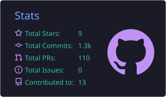
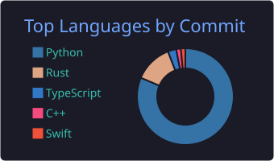

Somewhere between too much coffee and stubborn optimism, I build software that mostly does what it's told.

I've been writing code since I was 16. I started because turning nothing into something that actually runs felt like the closest thing to magic I could get my hands on, and that feeling never really wore off.

By day I write C++ machine vision software for automotive production: cameras, algorithms and a tight cycle time. The rest of the time I build the tools I wish already existed. Usually open source, usually privacy-first, always because I got curious about something and couldn't let it go.

### Things I've built

| Project | What it is | Stack |
|---|---|---|
| **[Pythia](https://github.com/SenseiIssei/Pythia)** | Paper-first trading cockpit with a research lab that counts every try. Ships in paper mode, because losing money by accident isn't a feature. | Rust, Python, Tauri |
| **[Sensei](https://github.com/SenseiIssei/Sensei)** | Self-hosted AI workspace that compresses prompts before they leave your machine. 79% fewer tokens, measured. | Python |
| **[Odysync](https://github.com/SenseiIssei/Odysync)** | Safe software and driver updates for Windows, macOS and Linux, without winget. A full Rust rewrite of my old Python updater. | Rust, Tauri, React |
| **[Caruspex](https://github.com/SenseiIssei/Caruspex)** | Vehicle diagnostics: OBD-II via ELM327, VW/Audi K-Line, live data and trouble codes. | C++20, Qt 6 |
| **[HYAKKI](https://github.com/SenseiIssei/HYAKKI)** | Idle auto-battler through Japanese folklore with zero art and zero audio assets. Every sprite is a pixel grid, every sound is synthesized. | TypeScript, Tauri |
| **[Mercy SF](https://mercysf.app)** | Desktop app that automates Shakes & Fidget: quests, arena, dungeons, fortress, the lot. | Rust, Tauri, React |
| **[CodeForge](https://github.com/SenseiIssei/CodeForge)** | Learn to code and prep for interviews in one desktop app, seven languages, English and German. | Python |
| **[ma](https://github.com/SenseiIssei/ma)** | App blocker for iPhone: breathe, answer a question, then decide. | Swift |

There are usually a couple more experiments quietly running in the background.

### Tools I reach for

Mostly Rust, Python and TypeScript/React these days, with C++, C# and Java never far away. For the desktop side I lean on Tauri, and everything runs on Linux.

### Activity

 

<picture>
  <source media="(prefers-color-scheme: dark)" srcset="https://raw.githubusercontent.com/SenseiIssei/SenseiIssei/output/github-snake-dark.svg" />
  
</picture>

<!--START_SECTION:activity-->
<!--END_SECTION:activity-->

### Say hi

If you're working on something interesting, or just want to talk shop, hmu. And if something I made saved you some time, you can buy me a coffee on [Ko-fi](https://ko-fi.com/senseiissei).
